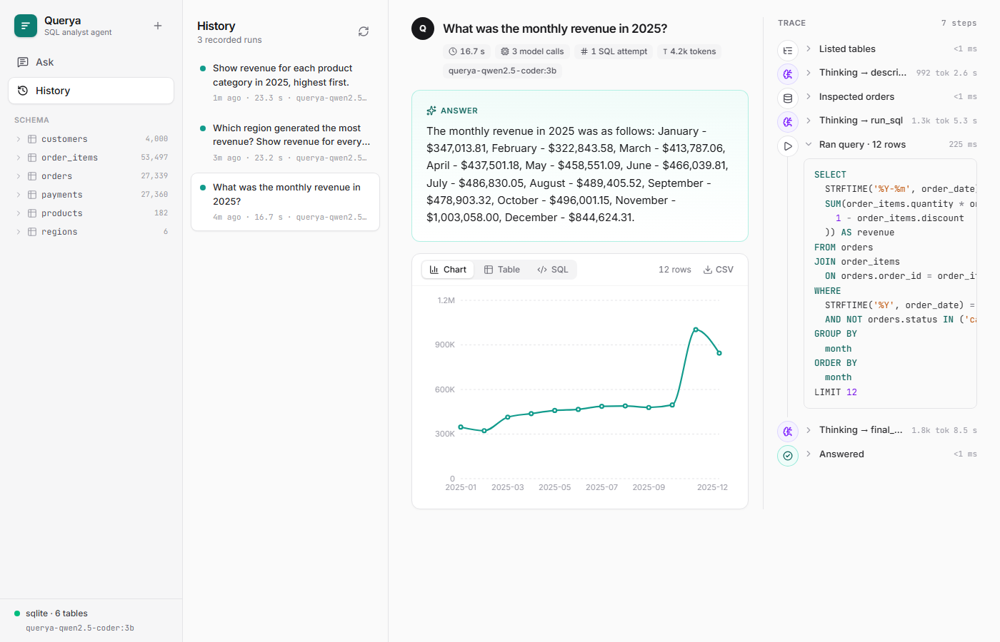
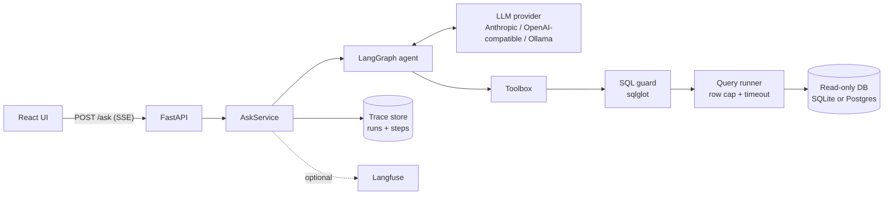
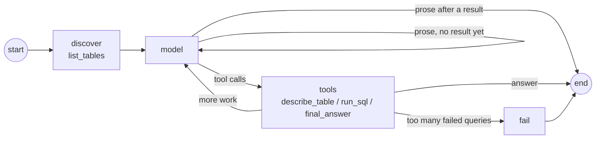

# Querya

Ask business questions in plain English and get answers from a SQL database, with every query checked before it runs, every step traced, and an eval set that measures how often the answers are right.



## Why I built this

"Chat with your database" demos are easy to make and hard to trust. The model writes SQL you never see, nothing stops it from running a `DELETE`, and nobody knows how often the numbers are wrong. I wanted to build the version I would be comfortable putting in front of a finance or ops team: the database connection is read-only, generated SQL goes through a parser-based guard, the agent shows its work step by step, and there is a repeatable eval that scores answers by their values instead of by eyeballing them.

## Features

- **Agent loop built with LangGraph**: list tables, inspect the ones it needs, write SQL, run it, read the error and fix the query (up to a retry limit), then answer with the numbers and the SQL it used.
- **Three layers of SQL safety**
  - A guard that parses every query with sqlglot and only lets a single `SELECT` through. DDL, DML, `PRAGMA`, `ATTACH`, `COPY`, `SET`, `SELECT INTO`, `FOR UPDATE`, data-modifying CTEs, system catalogs, unknown tables and functions like `pg_sleep`, `load_extension` or `query_to_xml` are rejected. A `LIMIT` is added or capped.
  - A read-only connection: SQLite is opened with `mode=ro` and `PRAGMA query_only`, Postgres sessions use `default_transaction_read_only` and the compose setup connects with a role that only has `SELECT`.
  - A per-query time limit (`statement_timeout` on Postgres, a progress handler on SQLite).
- **Pluggable LLM**: a small provider interface with an Anthropic client (official `anthropic` SDK, default model `claude-opus-5-5`) and an OpenAI-compatible client that also works with Ollama. Tests use a scripted fake.
- **Tracing**: each step (model call, tool call, SQL, rows, latency, tokens) is stored in a local trace table and shown in the UI. Langfuse export can be switched on with one env var.
- **Evals**: 33 questions with reference queries. The runner compares result values (not SQL text), and reports execution accuracy, model calls, SQL attempts and latency.
- **API**: FastAPI with `POST /ask` streaming agent steps over Server-Sent Events, plus run history and schema endpoints.
- **UI**: React + TypeScript + Tailwind. Suggested questions, a live step timeline with highlighted SQL, a result table, an automatic bar or line chart when the result shape fits, CSV export, and a history view with full traces. Works in light and dark mode and on small screens.

## Architecture



The agent graph:



A few decisions worth calling out:

- The first step always lists the tables (with column names) so a small model starts with the schema in view. `describe_table` adds types, keys and sample rows when it needs them.
- `final_answer` is refused if no query has succeeded yet, or if it arrives in the same turn as the `run_sql` call whose result the model has not seen. This stopped the small model from inventing numbers.
- Business definitions live in a short glossary (`src/querya/agent/glossary.md`): what "revenue" means, which order statuses count, and so on. Without it, "revenue" can be computed five reasonable ways and the evals become guesswork. Point `QUERYA_GLOSSARY_PATH` at your own file for another dataset.
- Guard errors and database errors are sent back to the model as tool results, so a bad column name turns into a retry instead of a crash.

## Sample data

`querya seed` generates a fictional retail dataset with a fixed seed: 6 regions, 4,000 customers, 182 products, about 27k orders, 53k order items and 27k payments covering 2024 and 2025. It has growth over time, a November/December peak, a Black Friday week, category seasonality, returns, cancellations and failed payments, so questions have non-trivial answers. The SQLite file is about 7 MB and is not committed; it is generated in a few seconds.

## Tech stack

Python 3.12, FastAPI, LangGraph, SQLAlchemy 2, sqlglot, Pydantic v2 and pydantic-settings, Anthropic and OpenAI SDKs, pytest, ruff, mypy (strict). React 19, TypeScript, Vite, Tailwind CSS 4, Recharts, highlight.js. SQLite for local use, PostgreSQL through Docker Compose, Ollama for local models.

## Running it

Requirements: [uv](https://docs.astral.sh/uv/), Node 20+, and either Ollama or an Anthropic API key.

```bash
# backend
uv sync
uv run querya seed                 # writes data/retail.db
uv run querya serve                # http://127.0.0.1:8000

# frontend (dev server with a proxy to the API)
cd frontend
npm install
npm run dev                        # http://localhost:5173
```

`npm run build` puts the UI in `frontend/dist`, and `querya serve` will then serve it at the root, so one process is enough.

To use a local model:

```bash
ollama pull qwen2.5-coder:3b
# optional, keeps the model fully on a small GPU (see the Modelfile)
ollama create querya-qwen2.5-coder:3b -f ollama/qwen2.5-coder-3b.Modelfile
export QUERYA_LLM_MODEL=querya-qwen2.5-coder:3b
```

To use Claude instead:

```bash
export QUERYA_LLM_PROVIDER=anthropic
export ANTHROPIC_API_KEY=...
```

From the terminal:

```bash
uv run querya ask "Which region generated the most revenue?"
uv run querya eval                  # full eval set, writes evals/results/
uv run querya eval --only aov_2025,busiest_day
```

With Docker (Postgres, a seed job and the API; the LLM defaults to Ollama on the host):

```bash
cp .env.example .env               # set POSTGRES_PASSWORD and QUERYA_RO_PASSWORD
docker compose up --build          # http://localhost:8000
```

### Tests and linting

```bash
uv run pytest
uv run ruff check . && uv run ruff format --check .
uv run mypy src
cd frontend && npm run lint && npm run build
```

The tests cover the SQL guard (67 hostile inputs across SQLite and Postgres, plus limit handling), the read-only connection and timeout, the tools, the agent loop with a scripted fake LLM (including the error-and-fix path, retry limits, refused early answers and LLM failures), both provider clients against SDK response objects, the trace store, the Langfuse mapping, the eval matcher and the API including the SSE stream.

## Configuration

All settings are environment variables (a `.env` file works too). See `.env.example`.

| Variable | Default | What it does |
| --- | --- | --- |
| `QUERYA_DATABASE_URL` | `sqlite:///data/retail.db` | Database the agent reads. SQLite or `postgresql+psycopg://...` |
| `QUERYA_TRACE_DATABASE_URL` | `sqlite:///data/traces.db` | Where runs and steps are stored |
| `QUERYA_LLM_PROVIDER` | `openai` | `openai` (any OpenAI-compatible server, including Ollama) or `anthropic` |
| `QUERYA_LLM_MODEL` | `qwen2.5-coder:3b` / `claude-opus-5-5` | Model name; the default depends on the provider |
| `QUERYA_OPENAI_BASE_URL` | `http://localhost:11434/v1` | OpenAI-compatible endpoint |
| `QUERYA_OPENAI_API_KEY` | `ollama` | Key for that endpoint |
| `ANTHROPIC_API_KEY` | | Read by the Anthropic SDK (or set `QUERYA_ANTHROPIC_API_KEY`) |
| `QUERYA_ANTHROPIC_SHOW_THINKING` | `true` | Ask Claude for summarized thinking so it shows up in the trace |
| `QUERYA_LLM_TEMPERATURE` | `0` | Sampling temperature for the OpenAI-compatible client (not sent to Anthropic) |
| `QUERYA_MAX_ROWS` | `200` | Row cap the guard enforces with `LIMIT` |
| `QUERYA_STATEMENT_TIMEOUT_MS` | `5000` | Per-query time limit |
| `QUERYA_MAX_SQL_RETRIES` | `3` | Failed queries allowed before the run gives up |
| `QUERYA_MAX_STEPS` | `12` | Model calls allowed per question |
| `QUERYA_GLOSSARY_PATH` | bundled glossary | Business definitions added to the system prompt |
| `QUERYA_LANGFUSE_ENABLED` | `false` | Export finished runs to Langfuse (uses the standard `LANGFUSE_*` variables) |

## Results

All numbers below come from one run of `querya eval` on the SQLite dataset, saved in `evals/results/`. Model: **qwen2.5-coder:3b** through Ollama's OpenAI-compatible API, with `num_ctx` set to 8192 through `ollama/qwen2.5-coder-3b.Modelfile`, temperature 0. Hardware: a GTX 1050 Ti (4 GB) that was shared with another job during the run, so treat the latency as a rough upper bound.

| Metric | Value |
| --- | --- |
| Questions | 33 |
| Execution accuracy (result values match the reference) | **21 / 33 (63.6%)** |
| Runs that ended with an answer | 31 / 33 (93.9%) |
| Model calls per question (avg) | 3.67 |
| SQL attempts per question (avg) | 1.39 |
| Trace steps per question (avg) | 8.18 |
| Latency per question (avg / median / max) | 42.2 s / 36.3 s / 169.9 s |
| Tokens over the whole run (in / out) | 160,391 / 5,999 |

What the 12 failures look like:

- **Wrong metric shape (5)**: average order value computed per line item instead of per order, a cancellation rate filtered down to non-cancelled orders, "units per order" returned as a single total, "which product" answered with a `product_id` instead of the name, and revenue growth returned as two yearly totals instead of a percentage.
- **Wrong filter or source (4)**: Black Friday week read as all of November, shipping fees summed from payments, the mobile share computed without the status rule, and "orders in each status" filtered with the glossary rule even though the question asks for every status. That last one is arguably an ambiguity in my eval set rather than a model error.
- **Gave up after retries (2)**: gross profit by category and the Electronics subcategory breakdown, where the model kept writing invalid SQL until the retry limit.
- **Missing groups (1)**: revenue by category came back with 5 of 7 categories.

The error-and-fix loop did its job in several passing cases: `top_category_2024` needed 3 SQL attempts and `customers_without_orders` needed 2.

For a single question with the GPU free, the screenshot above took 16.7 s end to end: 3 model calls, 1 SQL attempt, about 4.2k tokens.

I did not run the eval set against Claude or Postgres from this machine (no API key or Postgres credentials here), so I am not claiming numbers for either.

## What I'd do next

- Run the same eval set against Claude and a 7B-14B local model to see how much of the gap is model size versus prompt and tooling.
- Few-shot retrieval: keep past questions with verified SQL and pull the closest ones into the prompt.
- Port the reference queries to Postgres and run the eval set there in CI with a service container.
- Let users mark an answer right or wrong in the UI and turn those into new eval cases.
- Cost and latency budgets per question, plus caching for repeated questions.
